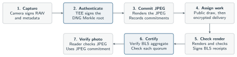

---
aliases:
- Illustrated IXH26 photo protocol
- Certified photo protocol from capture to verification
- Full-render protocol for an Apple secure DNG
---

# Certified photo protocol from capture to verification

The sensor authenticates the capture, the TEE commits its render inputs, and independent committees check the candidate JPEG one group of intervals at a time. A reader can verify the delivered file from the finalized certificate and the private opening. [Protocol write-up](../Shared_signing_for_verifiable_photo_origin.pdf)

## Full-render protocol

> Let
> - the capture registry bind the sensor key to a protected capture path and authenticate every render input against the same frame.
> - an approved SEP or other TEE authenticate the capture, extract the indexed DNG footprints and sign their [Merkle root](Attested%20DNG%20Merkle%20root.md) within its attested boundary.
> - the registered profile pin a deterministic integer RAW-to-JPEG renderer and conformance vectors. The registry pins the assignment policy and proof-of-possession BLS keys.
> - the finalized operator draw satisfy the [fault bound](Shared%20signing%20of%20a%20DNG%20render.md#signing-quorum) in every group. Assume sound attestation, unforgeable signatures and collision-resistant hashing.
>
> Then the ==full-render certificate== binds one exact reference JPEG to the authenticated capture under the registered profile.
>
> 
>
> 1. **Capture.** The camera sensor signs a unique frame ID with the RAW frame and sensor metadata. The TEE verifies that any off-sensor rendering metadata belongs to that frame and matches the job’s capture identifier to the hash of the registered sensor key ID and signed frame ID. [Apple secure digital negative](https://security.apple.com/blog/apple-reference-image/#technical-details)
> 2. **Authenticate the inputs.** The TEE verifies the capture and its metadata, extracts the DNG footprints and signs their Merkle root. It binds the signed Merkle root statement to the job, geometry and render metadata and returns the DNG footprints, tree data and attestation to the photo owner. [Attested DNG Merkle root](Attested%20DNG%20Merkle%20root.md)
> 3. **Commit the candidate.** The photo owner renders the candidate JPEG outside the TEE and registers both commitments. The first authorized submission fixes the job and the future randomness beacon round. [Exact reference JPEG commitment](Exact%20reference%20JPEG%20commitment.md)
> 4. **Assign the work.** The public draw assigns a committee to each group. The photo owner sends each operator their DNG footprints, inclusion proofs and JPEG interval openings off-chain using the public encryption key authorized by their wallet signing key. [XRPL verifier discovery and encrypted assignments](XRPL%20verifier%20discovery%20and%20encrypted%20assignments.md)
> 5. **Check the render.** Each operator checks the TEE evidence, develops every assigned footprint and checks the JPEG restart intervals against the candidate JPEG. For each verified group, the operator signs its group ID and ordered indexed interval digests together with the job digest, signed input statement digest and candidate commitment. [Authenticated DNG tiles](Authenticated%20DNG%20tiles.md) · [Shared signing of a DNG render](Shared%20signing%20of%20a%20DNG%20render.md)
> 6. **Certify.** The photo owner combines the BLS receipts into a BLS aggregate and submits it with the complete ordered digest vector and a signer bitmap for each committee. The contract recomputes the JPEG commitment, checks every group quorum and verifies the aggregate on the selected key and group-message pairs. [On-chain verification of a reference JPEG](On-chain%20verification%20of%20a%20reference%20JPEG.md) · [Coverage diagnostics](BLS-signed%20JPEG%20piece%20coverage.md)
> 7. **Verify the photo.** The photo owner delivers the JPEG and its master opening. The reader checks the finalized render certificate and verifies the exact delivered JPEG against the JPEG commitment. [Exact reference JPEG commitment](Exact%20reference%20JPEG%20commitment.md)
>
> > [!dim]- #### Proof
> > - The TEE derives the ordered tree after authenticating the capture, so each valid path binds the disclosed DNG footprint to its position and capture.
> > - Every accepted group contains an honest signer under the fault bound. That signer recomputed all its intervals and checked them against the same candidate commitment. The groups partition the intervals, so the commitment covers the complete deterministic reference render.
> > - The opening, indexed commitments, canonical header and strict marker parser bind the delivered file byte for byte.
>
> > [!warning]
> > - **Deployment.** Real capture requires a vendor-authorized TEE with access to authenticated sensor data and attestable root-building code. The hackathon can simulate the camera key and TEE. Deterministic RAW footprint rendering, BLS interoperability and contract execution bounds still need implementation and validation. [Full-render certificate prototype](../Proof_of_concept/README.md#the-seven-steps-in-code)

### How pixels form a tile

[Scattered restart interval assignments](Scattered%20restart%20interval%20assignments.md)
