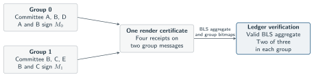

---
aliases:
- BLS aggregation of JPEG receipts
- Aggregate signing of a render
---

# Shared signing of a DNG render

## Full-render protocol

> Let
> - $J$ be the [canonical job](Exact%20reference%20JPEG%20commitment.md), with digest $j$, and let $a$ and $C_J$ be the committed root statement digest and candidate JPEG commitment.
> - $I_g$ be the interval indices in group $g$ of the [band layout](Scattered%20restart%20interval%20assignments.md). Let $A_g$ be the committee derived for group $g$ from the finalized [operator draw](XRPL%20verifier%20discovery%20and%20encrypted%20assignments.md), and $q_g$ its quorum.
>
> Then a ==full-render certificate== authenticates a quorum for every group against one candidate.
>
> 1. **Enroll receipt keys.** Bind one independent BLS12-381 key per operator and one operator per key in the pinned registry epoch. Use the minimal-signature-size proof-of-possession suite BLS_SIG_BLS12381G1_XMD:SHA-256_SSWU_RO_POP_ at the version pinned in the registry. Validate canonical encodings, group membership, nonidentity points and each proof of possession. [BLS proof-of-possession suite](https://datatracker.ietf.org/doc/html/draft-irtf-cfrg-bls-signature-07#section-4.2.3)
> 2. **Sign each verified group.** Check the finalized assignment and [attestation and root signature](Attested%20DNG%20Merkle%20root.md). For every $i\in I_g$, authenticate the input footprint, render it independently, compute the indexed output digest $d_i$ and verify its path to the candidate root $Q$. Recompute $C_J$ with the canonical header and match the finalized commitment. Once every interval in $g$ passes, sign the following message with indices in increasing order.
> $$M_g=\operatorname{enc}\bigl(\texttt{IXH26/jpeg-group-receipt/v1},j,a,C_J,g,((i,d_i))_{i\in I_g}\bigr).$$
> 3. **Assemble the certificate.** Verify each selected receipt against its enrolled key and $M_g$. Aggregate one signature per selected operator and group into $\Sigma$. Submit $K=(j,a,C_J,D,(B_g)_g,\Sigma)$ with $D=(d_0,\ldots,d_{n-1})$ in JPEG order. List the bitmaps $B_g$ in layout order, with one bit per member in that committee's roster order. Keep individual receipts for [coverage diagnostics](BLS-signed%20JPEG%20piece%20coverage.md).
> 4. **Verify.** Match the finalized job and commitments. Require exactly $n$ digests and recompute $C_J$ from their ordered tree and the canonical header. Derive the groups and committees from the job and draw. Validate every bitmap and require at least $q_g$ distinct selected members in each group. Reconstruct each $M_g$ from $D$ and use the proof-of-possession suite's $\operatorname{AggregateVerify}$ on $\Sigma$ and the list of $(PK_u,M_g)$ for every selected pair $(u,g)$.
>
> > [!note]
> > The signature has fixed size. The public certificate also carries 32 bytes per interval digest and one signer bitmap per committee. The private interval bytes and openings stay off-chain.

## Signing quorum

> Let $N_g=|A_g|$. Suppose at most $f_g$ operators in $A_g$ are faulty and at most $u_g$ additional honest operators are unavailable.
>
> 1. **Soundness.** Require $f_g<q_g$ for every group. Its selected signers then include an honest operator who checked all its intervals.
> 2. **Availability.** To tolerate both bounds, require $q_g\le N_g-f_g-u_g$. For example, two of three tolerates one faulty or unavailable operator. When one operator is faulty and another is unavailable, the job may fail.
>
> > [!example]
> > Groups 0 and 1 cover intervals $\{0,3\}$ and $\{1,2\}$. Their drawn committees are $\{A,B,D\}$ and $\{B,C,E\}$. Operators $A,B$ sign $M_0$ for indices $0,3$. Operators $B,C$ sign $M_1$ for indices $1,2$. Four receipts form one aggregate over both groups. A receipt from $B$ on $M_0$ contributes only to group 0. Group 1 needs its own receipt from $B$.
> >
> > 

## Future improvement

A future version could allow small measured render differences within an image-wide error budget while retaining a quorum in every group.
